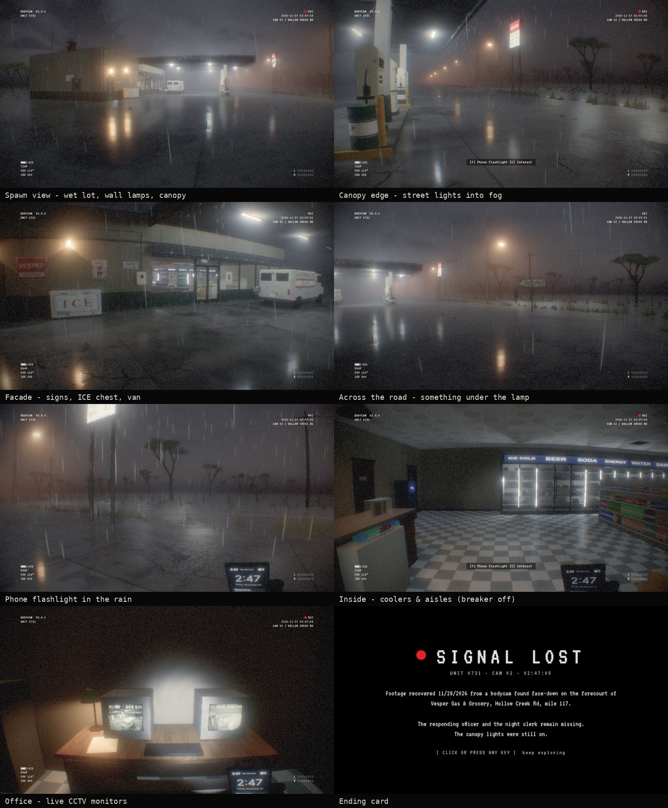

# NIGHT SHIFT — Vesper Gas & Grocery

An explorable, rain-soaked roadside gas station at 2:47 AM, rendered in **three.js** through the lens of a police **bodycam**. You carry a phone with its LED flashlight on. The night clerk stopped answering two hours ago.

Everything here is generated at runtime: geometry, PBR textures, signage, lighting and audio. The production build is about **880 KB**, with roughly 210 KB of gzipped JS and no image, model or audio files.



*These captures come from a CPU software renderer at reduced resolution and minimal bake quality, so expect a sharper, softer-shadowed result on a real GPU.*

## Run it

```bash
npm install
npm run dev        # http://127.0.0.1:5173
npm run build      # static site in dist/
```

Click **BEGIN RECORDING**. The browser locks the mouse and starts the audio.

| Key | Action |
| --- | --- |
| `W A S D` / arrows | move |
| mouse | look |
| `Shift` | run |
| `C` / `Ctrl` | crouch |
| `F` | toggle the phone flashlight |
| `Q` | raise / lower the phone |
| `E` | interact (doors, notes, phones, breaker, van) |
| `Esc` | pause |
| `F3` | performance overlay |

On touch screens, the left half of the screen is a move stick and dragging on the right half looks around. A quick tap interacts. If the browser or an embedding frame refuses mouse capture, it falls back to left-drag to look.

The quality setting is on the title screen (AUTO / LOW / MEDIUM / HIGH / ULTRA) and is saved to localStorage. AUTO picks a preset from the GPU. You can also pass `?q=high`.

## What's in it

- **Exterior**: concrete-block store with a parapet roof, chimney and TV aerial. Caged wall lamps and weathered tin signs. An ICE merchandiser, a bench, oil-drum bins, a payphone and a propane cage. A fluorescent canopy with chipped-paint pillars, steel Y-brackets, vintage pumps with hoses and painted bollards. An old radio-station cargo van. A lit price sign, cobra-head street lights that fade into the fog, power lines, a fence line and acacia-like trees.
- **Interior**: a checkered VCT floor and drop ceiling with two missing tiles. A glass-door cooler bank lit from inside, gondola aisles stocked with about 1,500 instanced products (procedural label atlas) and an L counter with register, lottery, candy rack and cigarette wall. Pendant lamps, a coffee station, a hot-dog roller, an ATM, an EXIT sign and a wet-floor sign. In the back: a stockroom with the breaker panel, an office with live **CCTV monitors**, and a restroom with a flickering vanity light.
- **Story**: the clerk's rules note and the shift logbook. A breaker that brings the sales floor back with a fluorescent start-up stutter, followed by a phone call you shouldn't answer. A payphone, the van's radio, a knock on the side door, and a figure across the road that is only there while you're watching. Something waits by pump 2 when the lightning flashes, and the CCTV shows a figure that isn't in the aisle. Answer the store phone and the night ends with the bodycam losing signal. You can keep exploring after the end card.
- **Life on the highway**: every couple of minutes a car hisses past in the rain. Its headlights bloom in the fog and streak across the wet asphalt, and the tire noise is positional with doppler.

## Rendering

The pipeline is custom, built on `WebGLRenderer`.

1. **Progressive GPU light baking at load.** About 45 static lights (tubes, bulbs, panels and street lights) are baked with soft area shadows from jittered cube distance maps. Results go into:
   - a packed **lightmap atlas**, with per-face charts generated by the geometry builder and rasterised in UV space with dilation,
   - a **planar ground lightmap** covering the lot, road and store floors,
   - **per-vertex and per-instance** irradiance for curved props, products and trees (read in the vertex shader through `gl_VertexID` / `gl_InstanceID`),
   - **sky visibility** for ambient light, rain wetness and lightning, which therefore get shadows for free,
   - three **switchable light groups**: the breaker, a faulty canopy tube and a faulty interior troffer.

   A preview is ready in well under a second on a real GPU. Refinement continues in the background over the first few seconds of play. At runtime each surface does a lightmap lookup plus a single dynamic shadowed spot light (the flashlight).
2. **Directional lightmaps**, so normal maps react to the baked lights.
3. **Planar reflections** (half resolution, mirrored camera) with a vertically biased blur chain. They give the long streaky reflections on wet asphalt, mirror-like puddles with **procedural rain ripples**, and a polished shop floor.
4. **Wet materials** driven by baked sky exposure: darkening, gloss, puddles and wall streaks. Under the canopy and indoors stays dry.
5. **Atmosphere pass**: exponential height fog, an analytic in-scatter integral for about 30 lamps (halos), and a ray-marched, **shadowed volumetric flashlight beam** with drifting mist.
6. **GPU rain**: about 12k camera-wrapped streaks, masked under the roof and canopy, lit by nearby lamps and the flashlight cone. Also ground splashes and drip lines off the canopy edges.
7. **Bodycam post**: HDR mip-chain bloom, auto-exposure (which drives the HUD's ISO readout), AgX tone mapping, split-tone grade, barrel distortion with chromatic aberration, camera motion blur, vignette and shadow-weighted sensor noise.
8. **Box-projected reflection probes** (PMREM), captured after the bake.
9. **Procedural WebAudio**: rain that muffles indoors, drumming on the metal canopy, HRTF-positioned fluorescent buzz that follows the flicker, and cooler hum. Also surface-aware footsteps, the door chime, thunder, the phone bell and radio static. The HUD's L/R meters are driven by the real mix.

### Performance design

- The static world is merged by material, region and lighting mode into roughly 110 meshes. Bake casters merge into one draw.
- Static lighting costs only texture fetches. The flashlight is the only real-time light and the only per-frame shadow map.
- Reflections render at half resolution and volumetrics at quarter or half resolution. Bloom uses a mip chain.
- **Dynamic resolution** targets 60 fps (between 55% and 100% render scale). The quality presets scale MSAA, the lightmap, bake samples, shadow-map size and effect resolution.
- Shaders are precompiled during loading with the final light setup. Material features (wetness, paint, grime, streaks, box projection) are uniform-driven rather than `#define` variants, which keeps the scene to about 80 programs instead of 160.
- CCTV feeds render at 10 Hz and only when you are nearby. Light glows are re-ranked every frame so the 32 most relevant ones go to the atmosphere pass.
- The phone light softens when a surface is within arm's reach (a cheap 2D raycast against the colliders), so close objects don't blow out.

## Code map

```
src/
  main.js               bootstrap, loop, title screen
  config.js             quality presets
  game/                 Game (update loop, interaction, flicker), Events (story/scares), CCTV
  render/               Pipeline + post shaders
  bake/                 LightBaker (GPU light baking), Atlas (chart packing)
  gfx/                  TextureGen + surfaces (procedural PBR), Materials (shader patches), CanvasTextures (signage)
  world/                World assembly, GeoBuilder, materials, Rain, content/* (store, canopy, props, van, roadside, interior, sky, doors)
  player/               Player controller (bodycam motion, collisions), Flashlight (phone + spot light)
  audio/                procedural sound engine
  ui/                   HUD + styles
```

Debug URL parameters: `?cam=x,y,z,yawDeg,pitchDeg` (start pose), `&flash` (flashlight on), `&breaker` (sales-floor lights on), `&stats`, `&q=low|medium|high|ultra`. The quality can also be set with a hash: `#low`, `#medium`, `#high` or `#ultra`.
